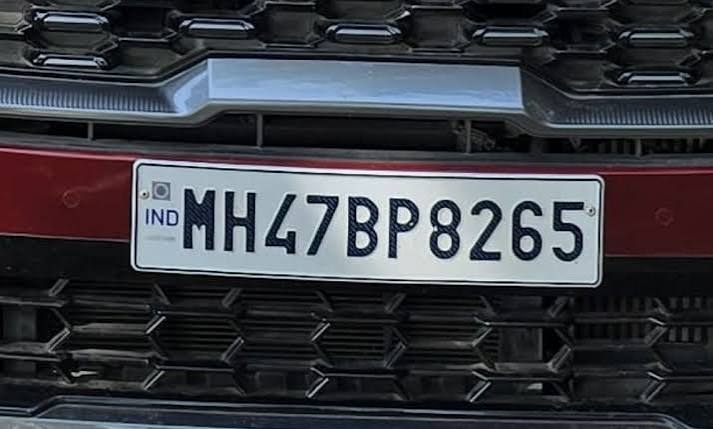
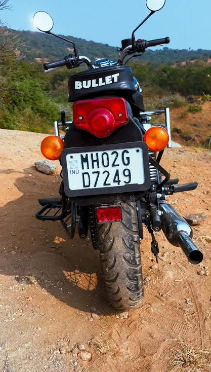

# 🚗 Campus Secure – Automated Vehicle Monitoring System

ANPR-based campus gate system built with **Python, OpenCV and Tesseract**. It goes beyond plate reading:
it decides who may enter, logs entry/exit automatically and flags visitors who overstay.

## Features
- Image preprocessing (grayscale, bilateral filter, Canny) and contour-based number-plate localisation
- OCR with **Indian plate format correction** (fixes O/0, I/1, S/5 using plate structure)
- Access decision engine: `ALLOW` / `DENY` / `ALERT` (blacklist) / `REVIEW` (unreadable)
- Auto ENTRY/EXIT toggling per vehicle and multi-gate logging (SQLite)
- Visitor overstay detection and CSV export of logs
- Streamlit dashboard: scan, register vehicles, view logs

## Setup
1. Install [Tesseract OCR](https://github.com/tesseract-ocr/tesseract) (Windows: add to PATH, or set `pytesseract.pytesseract.tesseract_cmd`).
2. `pip install -r requirements.txt`
3. `streamlit run app.py`

## Structure
```
app.py            Streamlit UI
src/anpr.py       preprocessing, localisation, OCR
src/database.py   SQLite vehicles + logs
src/rules.py      access decisions
```

## Future work
Live camera/RTSP feed, YOLO plate detector, SMS/email alerts, night-time enhancement.

## Screenshots







